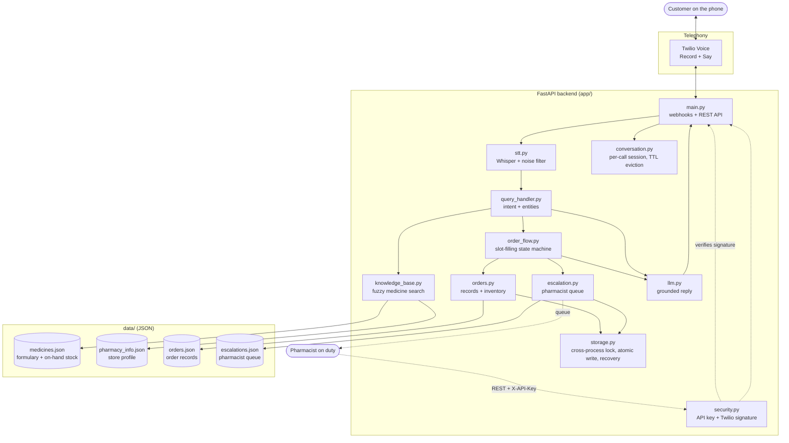
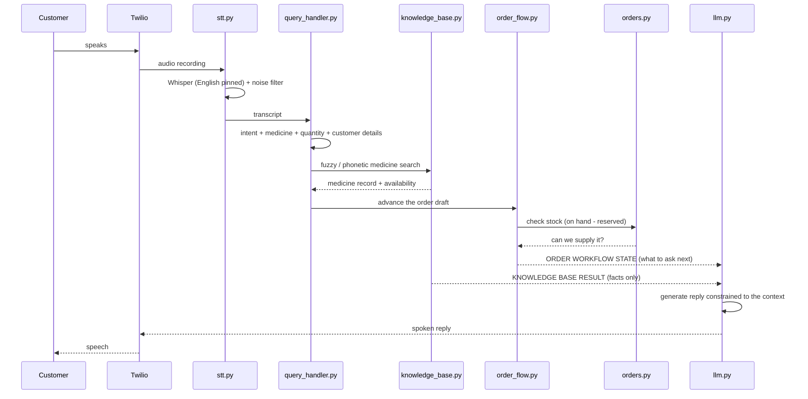
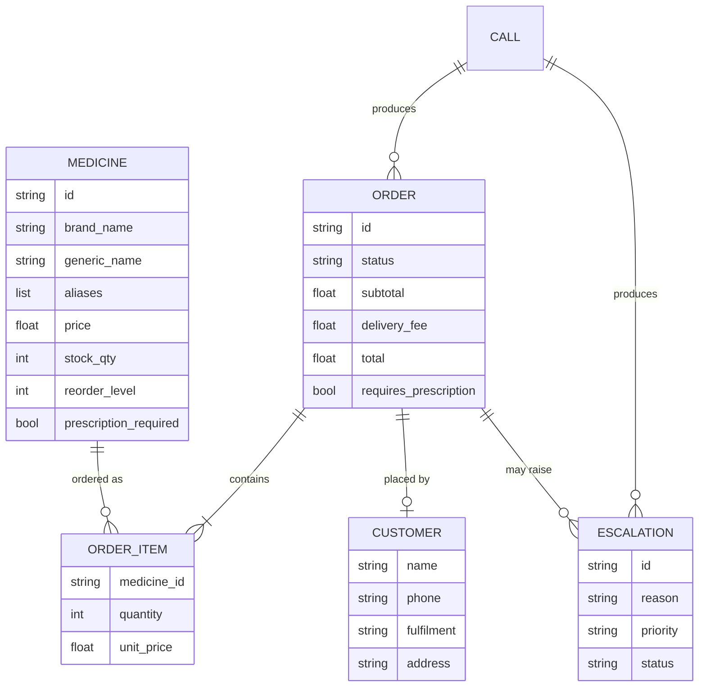
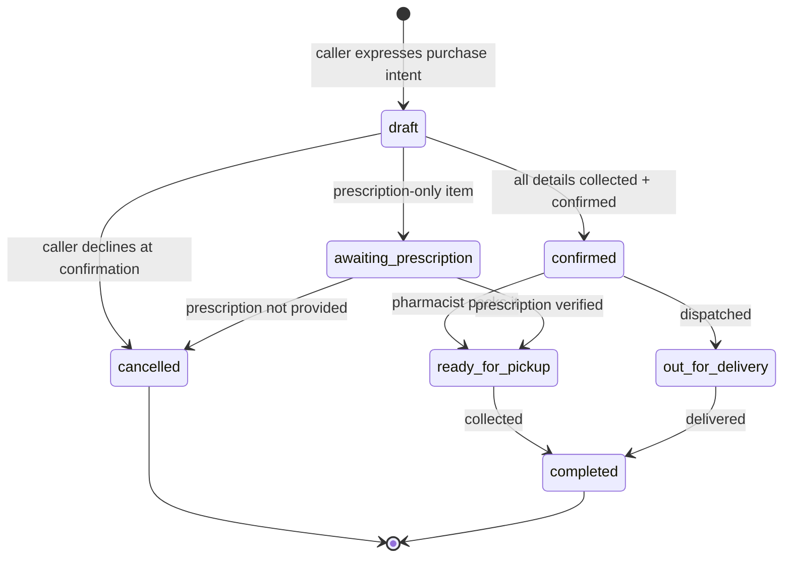

# MediTrack AI — Final Architecture

Stage II MVP. This document is the architectural reference for the Week 4
demonstration: what the components are, how a call flows through them, and why
the significant decisions were made.

Week 4 added a hardening pass in response to a structured review (18 failing
scenarios spanning input validation, security and recovery — see the "Week 4
hardening" section below and `tests/test_negative.py`, which pins each one as
a regression test).

## 1. System overview

## 2. Turn pipeline

Every customer utterance follows the same path. The knowledge base and order
state are assembled into a **grounding context** that the LLM must answer from.

## 3. Components

| Module | Responsibility | Key decision |
|---|---|---|
| `main.py` | Twilio webhooks, REST API for pharmacist and inspection | Same pipeline serves phone and HTTP |
| `stt.py` | Whisper transcription, hallucination filtering, pharmacy vocabulary priming | Language pinned to English; silence never reaches the agent |
| `knowledge_base.py` | Formulary loading, fuzzy + phonetic search, availability | Phonetic index absorbs speech-recognition errors |
| `query_handler.py` | Intent classification, medicine/quantity/customer-detail extraction, grounding context | Deterministic regex + scoring, not model-guessed |
| `order_flow.py` | Slot-filling state machine, escalation triggers, status lookup | Sequence is code; only the wording is model-generated |
| `orders.py` | Order records, totals, inventory reservation, persistence | Reservations, never stock mutation |
| `escalation.py` | Prioritised pharmacist queue | Anything the AI must not decide alone |
| `llm.py` | Grounded reply generation, provider abstraction | Answers only from the supplied context |
| `conversation.py` | Per-call session and draft order | Call id ties orders and escalations to the recording; sessions expire on a TTL and a hard count cap |
| `security.py` | Staff API key check, Twilio signature verification | Both fail closed: an unset secret refuses to serve rather than opening up |
| `storage.py` | Shared JSON persistence for `orders.py` and `escalation.py` | Cross-process file lock, atomic write with a pre-write backup, corrupt-file recovery |
| `config.py` | Environment-driven settings | No secrets in code |

## 4. Data model

## 5. Order lifecycle

Every status except `completed` and `cancelled` holds stock in reserve, so
availability is always `on_hand − reserved`.

## 6. Escalation routing

| Trigger | Priority | Order effect |
|---|---|---|
| Dosage / interaction / diagnosis question | High | none — never answered by the AI |
| Caller asks for a human | High | none |
| Refrigerated (cold chain) item ordered | High | order flagged |
| Prescription-only medicine ordered | Normal | held as `awaiting_prescription` |
| Requested quantity exceeds available | Normal | order refused |
| Medicine out of stock | Low | order refused, alternatives offered |

## 7. Design decisions

**The state machine decides; the LLM only speaks.** `order_flow.py` computes
which detail is missing, checks stock, calculates totals and decides when to
escalate. The model receives an explicit instruction for the next question. The
wording is natural, but the sequence, arithmetic and stock decisions are
deterministic and unit-testable, and the model is never asked to remember what
it has already collected.

**Grounded generation.** Each turn carries a context block listing exactly the
facts the model may state. The system prompt forbids inventing a medicine,
price or stock number. When the search finds nothing, the block says so and the
agent asks the caller to repeat rather than guessing.

**Stock is never mutated.** `medicines.json` is the pharmacy's record of what is
on the shelf and is read-only. Reservations live in `orders.json`. Cancelling
an order releases its stock automatically, and the formulary stays a single
source of truth. Real deduction belongs at dispense time in the POS.

**Phonetic search over exact matching.** Drug names are the hardest words for
speech recognition. Names are reduced to a sound-alike key (`ph`→`f`, `c`→`k`,
non-leading vowels dropped) so `amoxy sillin`, `paracetemol` and `ventalin`
resolve correctly, with length and literal-similarity guards to stop ordinary
English words matching by accident.

**Fail safe, not silent.** No LLM key, a failed API call, an unrecognised
medicine or an unfulfillable quantity each produce a correct spoken answer from
the knowledge base rather than an error or a guess.

## 8. Technology

| Layer | Choice | Why |
|---|---|---|
| Telephony | Twilio Voice | Standard, works with a local ngrok tunnel |
| Speech-to-Text | OpenAI Whisper (`whisper-1`) | Best accuracy on drug names; prompt-primeable |
| STT fallback | SpeechRecognition / Google | Keeps the pipeline running without a key |
| LLM | OpenAI `gpt-4o-mini` or Anthropic Claude | Provider-agnostic behind one interface |
| Backend | FastAPI + Uvicorn | Async, automatic OpenAPI docs |
| Storage | JSON files | Zero setup for the MVP; swap for a database in production |

## 9. Week 4 hardening

A structured review ran 190 test cases by hand against the Week 3 submission
and found 18 failing scenarios — all passing the offline suite, none of them
covered by it. Each is now a named regression test in `tests/test_negative.py`
and is fixed as follows:

| Area | Was | Now |
|---|---|---|
| Order quantities | Zero and negative pack counts were accepted and persisted (one with a negative total); a spoken minus sign was stripped by normalisation; a 999-pack request was bounded only by whatever was on the shelf | `orders.validate_quantity()` refuses non-positive, non-integer and above-limit counts before they reach pricing or the file; `query_handler.parse_quantity()` reads the sign from the raw transcript and reports *why* a count was refused, so the order flow re-asks instead of defaulting to one pack |
| Intent routing | "Can I mix amoxicillin with paracetamol?" fell through to `UNKNOWN`, past the clinical safety gate; "What is your return policy?" was read as a medicine question; "I need human help" matched the generic purchase pattern | Added interaction/combination patterns to the `CLINICAL` group (checked first, so it cannot be starved by an earlier match), store-policy patterns to `STORE_INFO`, and person/human-request patterns to `PHARMACIST` |
| Input size | 40,000 characters of input ran for over four minutes in the n-gram medicine search, blocking the worker thread — a denial-of-service path on a public webhook | `query_handler.clamp_text()` bounds an utterance by character count before analysis (voice path truncates and continues; the `/query/analyze` HTTP path rejects with 413); a second token-count cap bounds the n-gram scan even for input under the character limit |
| Startup | A missing or corrupt `medicines.json` raised at import time — `app.llm` built its system prompt eagerly, so importing it read the formulary and crashed the whole process before any handler existed to catch it | `PharmacyKnowledgeBase.load()` catches the read failure, records `load_error`, and the app starts in a `degraded` state; `/health` reports it; routes that need the formulary depend on `require_knowledge_base()` and return 503 with the reason; `SYSTEM_PROMPT` is now resolved lazily via module `__getattr__` |
| Staff API | All 13 REST endpoints (orders, escalations, formulary, query analysis) served without credentials | `security.require_api_key()` gates every staff endpoint behind `X-API-Key`, compared with `hmac.compare_digest`; an unset `ADMIN_API_KEY` fails closed (503), never open |
| Voice webhooks | `/voice/incoming` and `/voice/process` accepted a POST from any source, so a stranger who found the ngrok URL could inject a fake call | `security.verify_twilio_signature()` validates `X-Twilio-Signature` against the exact URL and body with Twilio's own `RequestValidator`; an unset `TWILIO_AUTH_TOKEN` fails closed |
| Outbound calls | No timeout on the LLM call, the STT call, or the Twilio recording download — any one of them could hang a call indefinitely | `LLM_TIMEOUT_SECONDS`, `STT_TIMEOUT_SECONDS`, `TWILIO_DOWNLOAD_TIMEOUT_SECONDS` bound every outbound request; a timeout falls through to the existing knowledge-base-only reply |
| Session lifecycle | Sessions lived in a plain dict for the lifetime of the process; a call that never got a final Twilio callback (a drop, a crash) leaked forever | `conversation.py` tracks last-seen time per session, sweeps anything idle past `SESSION_TTL_SECONDS` on every access, and evicts oldest-first once `MAX_ACTIVE_SESSIONS` is reached |
| Silence on the line | The fallback recogniser's network call raised an uncaught `OSError`/`TimeoutError` on silence or a bad connection, which propagated out of the webhook as a 500 and ended the call | `stt.transcribe_audio()` never raises — it returns `""` on any transcription failure, which `is_probable_noise()` already treats as noise, so the agent re-prompts and the call continues; `main.py` also wraps the download and the LLM call so no single turn can end the session |
| Concurrent writers | `threading.Lock` only serialises threads in one process; two `uvicorn` workers each hold their own lock, so two could both reserve the last pack | `storage.file_lock()` takes an OS-level advisory lock (`fcntl`/`msvcrt`) on a sibling `.lock` file; every write re-reads the store inside that lock before checking stock, so a sibling worker's reservation is always seen |
| Recovery | A corrupt `orders.json` or `escalations.json` crashed on load, with no backup and no recovery path | `storage.atomic_write_json()` keeps a `.bak` before every write; `storage.load_json()` recovers from it on a damaged main file, quarantines the bad file as `<name>.corrupt-<timestamp>` for inspection, and starts empty only if the backup is unusable too — never raises |
| Medicine matching | "daily" phonetically matched Centrum through its alias "daily vitamin" — an ordinary English word read as a stocked product | The substring-containment shortcut in `_score_name()` now requires a whole-word boundary and is skipped for phrases made entirely of generic words (`daily`, `cold`, `pain`, …), so those must clear the fuzzy threshold on their own merits |
| Test coverage | The 190-case suite was entirely happy-path; every failure above shipped green | Added `tests/test_negative.py` (42 cases): one test per defect above, plus guards that the surrounding happy path still works |

## 10. Known limitations

- **File-lock concurrency is single-machine.** `storage.file_lock()` correctly
  serialises multiple `uvicorn` workers on one host, but not multiple hosts
  sharing the JSON files over a network filesystem — a real multi-node
  deployment needs a database with real transactions.
- **In-memory sessions.** A process restart loses any order mid-collection;
  the TTL only bounds a *leak*, it does not persist state across a restart.
- **Fixed-window recording.** Turn-taking is `<Record>`-based rather than
  streaming, so the agent cannot be interrupted mid-sentence.
- **Digit dictation is the weakest link.** Whisper occasionally drops a digit
  from a fast-spoken phone number; the agent accepts what it hears without a
  read-back confirmation.
- **A single shared API key**, not per-pharmacist accounts or audit-logged
  access — adequate for one pharmacy's back office, not for multi-tenant use.
